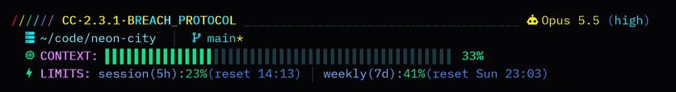
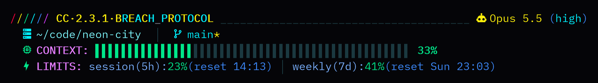
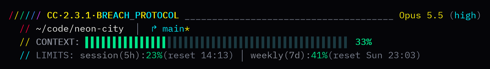
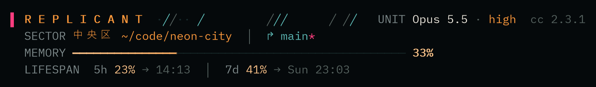
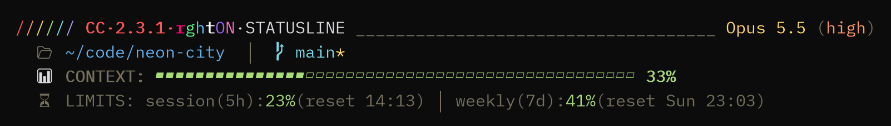
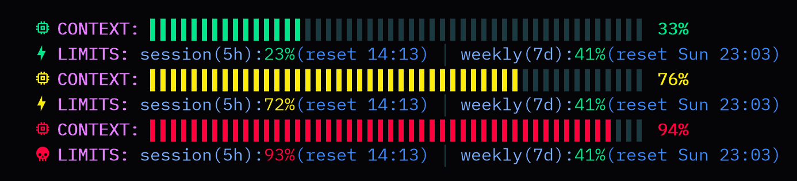

# rghtON statusline for Claude Code

A four-line status line for [Claude Code](https://claude.com/claude-code) with
two neon looks: **Breach**, a cyberpunk HUD whose sign glitches, and
**Replicant**, Blade Runner noir with a neon sign and rain. It also has the
plain **rghtON** look with ten colour themes. It shows the model, folder and
git branch, how full the context is, and your 5-hour and weekly usage limits.



| | |
|---|---|
| **Breach** (Nerd Font icons, `cool` text) |  |
| **Breach** (no Nerd Font needed) |  |
| **Replicant** |  |
| **rghtON** |  |

Numbers change colour as they fill up: green while there is room, yellow from
70 %, red from 90 %. Breach's limit bolt turns into a skull near the 5-hour limit.



## Install

You need **jq** and **git**. On Windows you also need **Git for Windows**
(the script runs in Git Bash).

### Windows

```powershell
winget install Git.Git jqlang.jq        # if you don't have them yet
git clone https://github.com/dawid-walter/rghton-statusline
cd rghton-statusline
.\install.ps1
```

If PowerShell refuses to run the script, use
`powershell -ExecutionPolicy Bypass -File .\install.ps1`.

### Linux, WSL, macOS

```sh
sudo apt install jq        # or: brew install jq
git clone https://github.com/dawid-walter/rghton-statusline
cd rghton-statusline
./install.sh
```

The script works with the bash 3.2 that ships with macOS, and faster with
bash 4.2 or newer (`brew install bash`).

Open Claude Code sessions pick the new status line up within a few seconds.
Restart a session if it does not.

### What the installer changes

- copies `statusline.sh` to `~/.claude/rghton-statusline/`
- sets only the `statusLine` entry in `~/.claude/settings.json`. Everything
  else stays, and a backup of the whole file goes to
  `~/.claude/rghton-statusline/backup/`
- writes the option files below

`-DryRun` / `--dry-run` shows all of that without changing anything.
`-Uninstall` / `--uninstall` puts back the status line and the option files you
had before.

## Options

Pass them to the installer, or change them later. Each option is a one-word
file in `~/.claude`, and the next refresh uses it.

| file in `~/.claude` | installer | values |
|---|---|---|
| `statusline_theme` | `-Theme` / `--theme` | `breach` (default), `replicant`, `herdr` (see below), `rghton`. For the rghtON look you can also name a colour theme: `monokai`, `dracula`, `nord`, `gruvbox`, `solarized`, `catppuccin`, `tokyo-night`, `one-dark`, `rose-pine`, `cyberpunk` |
| `statusline_icons` | `-Icons` / `--icons` | Breach's line icons. `slash` (default), `chip`, `bus`, `pixel`, `tag`, `gauge`, `typo`, `arrow` work with any font. `netrunner` and `terminal` need a [Nerd Font](https://www.nerdfonts.com/) |
| `statusline_text` | `-Text` / `--text` | Breach's text colours: `cool` (installer default), `cyan`, `gray` |
| `statusline_motion` | `-Motion` / `--motion` | `full` (default) or `min`, which stops the glitch, the rain and the shimmer |
| `statusline_timezone` | | a zone such as `Europe/Warsaw` for reset times. The default is your local time |

The installer also sets how often Claude Code redraws the status line:
`-Refresh 3` / `--refresh 3` (seconds, the default). The glitch and the rain
need this to move. `0` redraws only when something happens in the session.
One redraw takes about 0.25 s in Git Bash on Windows and about 15 ms on Linux.

For a one-off try, every file has an environment variable with the same
effect: `CC_THEME`, `CC_ICONS`, `CC_TEXT`, `CC_MOTION`.

### Fonts

Breach and Replicant are drawn for **IBM Plex Mono**, and every glyph in them
except the Nerd Font icon sets exists in it. Other monospace fonts work too.
For `netrunner` / `terminal` icons, use a Nerd Font, or a terminal that falls
back to an installed one.

## herdr

If you use [herdr](https://herdr.dev) with the Breach Protocol or Replicant
layouts, set the theme to `herdr`. The status line then follows the layout
shown in herdr-app, and reads its colours from herdr's theme files. With any
other herdr theme it shows rghtON. Set `HERDR_APP_DIR` if your herdr home is
not `~/.config/herdr-app`.

## Credits

Made by Dawid Walter. Breach's and Replicant's palettes come from the herdr
themes of the same names.

## License

[MIT](LICENSE)
